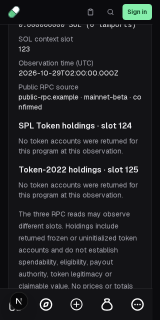
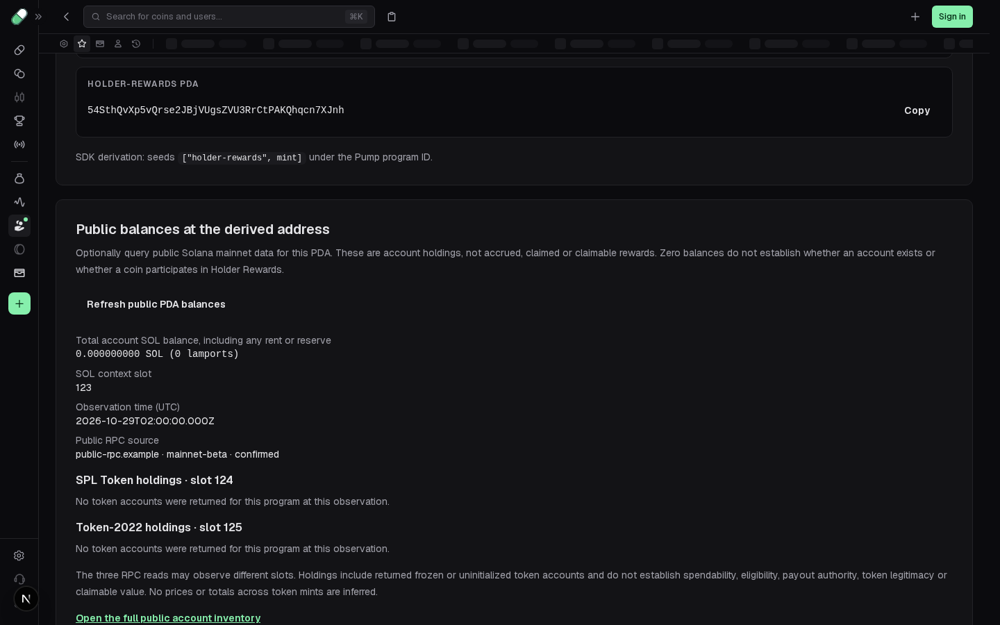

# Holder Rewards: opt-in public account inspection

`/holder-rewards` already derived a holder-rewards PDA from a mint using the published SDK. It now offers **Read public PDA balances** after derivation. Only this explicit action queries the existing same-origin `/api/portfolio` service. The result shows account SOL (including any rent/reserve), exact SPL Token/Token-2022 quantities, separate context slots, observation time and the sanitized RPC hostname. A refresh requests a new observation; editing or clearing the mint discards all old and pending results.

**Holdings are not rewards.** Accrued, claimed and claimable rewards remain `Unavailable`; the claim control stays disabled. Zero SOL/empty token accounts do not prove existence or absence, Pump-coin status, eligibility, configuration or payout authority. Token amounts do not establish spendability or legitimacy, and separate mints are never summed or priced. Returned frozen/uninitialized accounts may contribute to the existing service's inventory. The three balance reads may observe different slots.

## Authority and unchanged prerequisites

This is independent public-chain functionality, not an implementation of `GET /fees/holder-rewards` or a recovery of original backend source.

- The existing [holder-rewards evidence](HOLDER-REWARDS-EVIDENCE.md#captured-factories) binds captured page212065 to mint/PDA presentation. Its route, fields and copied addresses are existing work, not new recovery credit. The service origin/auth/availability of the original fees API remains unresolved.
- The unchanged published `@pump-fun/pump-sdk@4.3.1` helper derives `holderRewardsPda(mint)` under the Pump program. Existing tests compare the local derivation with both root and `/swap` exports from the immutable npm archive. SDK source/build files are untouched.
- [PORTFOLIO-RPC.md](PORTFOLIO-RPC.md) documents the existing public `getGenesisHash`, `getBalance` and two `getTokenAccountsByOwner` contracts, mainnet genesis check, independent slots, lossless quantities, owner/program validation, HTTPS/DNS pinning and server-owned configuration. Those methods accept a canonical account public key, including a PDA; they do not require signing or prove that it is a user wallet.
- No route, backend, RPC transport, endpoint configuration, response type, persisted materialization or authentication code is added or changed. Tests bind the unchanged derivation, API route, RPC adapter and types to exact SHA-256 values.

The existing service requires server-owned `SOLANA_RPC_URL`; without it, observations remain unavailable. Browsers cannot select an RPC URL. A public provider needs no external credential, but may be rate limited. No archived or synthetic response is used as a current balance fallback.

## Lifecycle and privacy

The browser sends one fixed same-origin GET with an encoded PDA, `credentials: omit`, `cache: no-store` and JSON Accept. It forwards no wallet/session credentials or body. The existing server then performs only its documented read RPC calls. The response must be a valid portfolio envelope for the exact derived PDA, mainnet cluster, correct program roles and token-account owner. A response for another address fails closed. Raw provider failures are not displayed.

The read is opt-in after every mint change: there is no request merely from page load or derivation. Editing/clearing/unmounting aborts and invalidates pending work; a late response cannot repopulate the old mint. Refresh clears the previous observation while loading. A 20-second client deadline is an explicit local policy. Nothing is persisted, and no wallet connection, message signing, transaction, mutation, eligibility or authenticated reward request exists.

## Repeatable checks

From `app`:

```sh
node --test tests/holder_public_balances.test.mjs
pnpm --filter @pump-reconstruction/backend exec tsx --test ../../tests/portfolio_rpc.test.ts
node --test tests/holder-rewards.test.mjs
pnpm --filter @pump-reconstruction/frontend exec tsc --noEmit --incremental false
pnpm --filter @pump-reconstruction/frontend exec playwright test tests/holder-rewards.spec.ts tests/holder-public-balances.spec.ts
```

The normal `pnpm test` wildcard includes the new `.test.mjs`. It uses the backend's already-pinned public tsx loader API to load maintained TypeScript; it never evaluates captured factories. Seven new groups cover fixed HTTP/privacy semantics, exact string quantities, mismatched identity/cluster/program/owner, invalid envelopes/JSON, HTTP/provider failures, cancellation and a real loopback HTTP success/rate-limit flow, plus unchanged prerequisite hashes. Existing four SDK-derivation and ten RPC groups also pass (21 combined).

Six product-browser cases cover explicit-only requests/no cookies, exact quantities/slots, refresh, provider failure/retry privacy, wrong-PDA rejection, edit/clear cancellation, zero/empty observations and 320/1440px containment. All six new and eight existing Holder Rewards product cases passed (14/14) on the actual local Next app. SDK/backend/Next production build, recursive typecheck, 698 app capture/npm/unchanged-SDK checks and progress verification with eight tests passed on the same runtime revision. Fixtures are synthetic protocol responses, not production observations; the HTTP fixture is a local transport test, not a Solana service oracle. Existing offline inspector behavior remains the default.

No original authenticated Holder Rewards screenshot or response oracle is available, so no original visual, reward API or exhaustive compatibility claim is made. Existing feature milestone statuses and operation qualification counts are unchanged.

## Recorded result

[Validation record](visual/holder-public-balances-20261029/validation.json) binds tested runtime `93d150b71f1c3e0c78f817cb39faec1689f9940e`, raw commands/logs/results and inspected 320×640 and 1440×900 local screenshots. The first browser attempt failed before any case ran because a dependency-directory symlink left Turbopack's root; hardlinking the pinned physical dependency layout fixed startup without source/lock/config changes. The failure is preserved. A separate direct public RPC read returned unavailable; that negative is retained and is not replaced with fixture balances. No successful live-chain or original rewards-service oracle is claimed.




